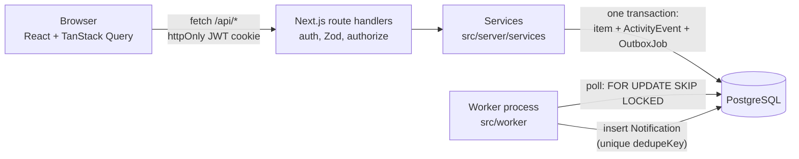

# Newtonite Ops

An internal tool for operational work items (incidents, customer issues, payment and compliance tasks).
Teams create items, claim or assign them, and move them through a fixed workflow
(OPEN, IN_PROGRESS, AWAITING_APPROVAL, RESOLVED, CLOSED). Only a team lead can approve.
Every change is recorded in an append-only history, and notifications are delivered by a separate
worker through a transactional outbox.

The focus is correctness under concurrency: atomic claims, optimistic locking, idempotent requests,
resource-level authorization, and a reliable outbox, each covered by tests against a real Postgres.

## Prerequisites

- Docker with Docker Compose v2 (that is all you need for `docker compose up`)
- To run outside Docker: Node.js 22+ and PostgreSQL 16

## Run it

```bash
docker compose up --build
```

This starts three containers: `db` (Postgres 16), `app` (Next.js on http://localhost:3000) and
`worker` (the outbox worker). On startup the app runs the migrations and seeds the database with
4 teams, 11 users and 5,000 work items. The seed is skipped if the database already has users.

Open http://localhost:3000 and log in with one of the demo users below.

To start from an empty database again: `docker compose down -v && docker compose up --build`.

## Demo users

All demo users have the password `password123`.

| Email | Teams and roles | Use it to show |
|---|---|---|
| `admin@newtonite.dev` | Payments: ADMIN | everything within their team |
| `lead@newtonite.dev` | Payments: LEAD | approving, reassigning, changing priority |
| `member@newtonite.dev` | Payments: MEMBER | create, claim, edit, start work; approval is refused |
| `member2@newtonite.dev` | Payments: MEMBER | a second member, for claim races |
| `viewer@newtonite.dev` | Payments: VIEWER | read-only (writes get 403) |
| `multi@newtonite.dev` | Payments: MEMBER, Support: LEAD | different roles in different teams |
| `sre.lead@newtonite.dev`, `sre.member@newtonite.dev` | SRE: LEAD / MEMBER | another team (no access to Payments) |
| `support.member@newtonite.dev` | Support: MEMBER | |
| `compliance.lead@newtonite.dev` | Compliance: LEAD | |
| `outsider@newtonite.dev` | no teams | sees nothing; every item is a 404 |

## Run the tests

The tests use a real Postgres database called `newtonite_test`, which is created automatically by
`docker/postgres-init.sql`. Nothing is mocked.

With the compose stack running:

```bash
docker compose exec app npm test
```

Or locally (Postgres on localhost:5432 with a `newtonite_test` database, see `.env.example`):

```bash
npm ci
npm test
```

`npm test` applies the migrations to the test database and runs every test file once. It refuses
to run against a database whose name does not end in `_test`, because the tests truncate tables.

What the tests cover (40 tests in `tests/`):

| Behaviour | Test file |
|---|---|
| Parallel claims: exactly one wins, the others get 409 | `claim.test.ts` |
| Stale `version` is rejected with 409 and the latest item; data unchanged | `optimistic-lock.test.ts` |
| Same `Idempotency-Key` twice, and in parallel, creates one item; different payload is 422 | `idempotency.test.ts` |
| Invalid jumps are 422; only LEAD/ADMIN can approve or reject | `workflow.test.ts` |
| Other teams' items are 404 on read and write and never listed; VIEWER gets 403 on writes | `authorization.test.ts` |
| Outbox job written in the same transaction; processed twice gives one notification; retries with backoff then FAILED; SKIP LOCKED | `outbox.test.ts` |
| History is append-only; keyset pagination visits every row once; server-side search | `history-and-pagination.test.ts` |

CI (`.github/workflows/ci.yml`) runs typecheck and lint, then does a clean `docker compose up`,
logs in as a seeded user, and runs `npm test` inside the app container.

## Run without Docker

```bash
cp .env.example .env        # then edit the values if needed
npm ci
npm run db:migrate
npm run db:seed
npm run dev                 # app on http://localhost:3000
npm run worker              # in a second terminal
```

## Architecture



- **Route handlers** (`src/app/api/**`) stay thin: authenticate, validate with Zod, call a service.
- **Services** (`src/server/services/*`) hold all business rules. Every one of them calls
  `authorize()` (`src/server/authorize.ts`) before reading or writing.
- **Writes** run in one database transaction: the item update, its ActivityEvent, and any outbox
  job are committed together or not at all.
- **The worker** is a separate Node process that claims due outbox jobs, runs idempotent handlers
  and retries failures with exponential backoff.
- **The browser** never filters or paginates by itself. Lists are server-side, keyset-paginated
  and refreshed by polling every 15 seconds.

More detail: [`docs/DESIGN.md`](docs/DESIGN.md) (data model, workflow, permission matrix, API) and
[`ENGINEERING_DECISIONS.md`](ENGINEERING_DECISIONS.md) (choices and trade-offs).

## API summary

| Method | Path | Notes |
|---|---|---|
| POST | `/api/auth/login` | sets the httpOnly cookie; also returns the token for `Authorization: Bearer` |
| POST | `/api/auth/logout` | |
| GET | `/api/me` | current user and team roles |
| GET | `/api/items` | `status, priority, type, team, assignee (id, me, none), q, view, cursor, limit` |
| POST | `/api/items` | `Idempotency-Key` header supported |
| GET / PATCH | `/api/items/:id` | PATCH requires `version` |
| POST | `/api/items/:id/claim` | atomic |
| POST | `/api/items/:id/transition` | `{ to, version }`, `Idempotency-Key` supported |
| GET | `/api/items/:id/activity` | cursor-paginated |
| POST | `/api/items/:id/comments` | |
| GET | `/api/teams/:id/members` | assignee dropdown |
| GET | `/api/notifications` | produced by the worker |

Errors always look like `{ "error": { "code": "VERSION_CONFLICT", "message": "...", "details": {} } }`.
Status codes: 400 invalid input, 401 not logged in, 403 role too low, 404 not found or not your team,
409 concurrency conflict (stale version, already claimed), 422 business rule (invalid transition,
idempotency key reused).

## Known limitations

- No team or membership management UI; teams and users come from the seed.
- No real-time push. The UI polls every 15 seconds and refetches on window focus.
- Notifications are rows in a table that the dashboard shows. No email or Slack delivery.
- Search is substring matching with `pg_trgm`. There's no ranking, stemming or typo tolerance.
- No rate limiting, password reset, or session revocation. A JWT is valid until it expires (8 hours),
  but roles are re-read from the database on every request.
- Outbox jobs marked FAILED stay in the table. There is no admin screen to inspect or retry them.
- The UI is deliberately plain.

## Next week I would

1. Add an admin view for FAILED outbox jobs with a "retry" button, plus a metric or alert on that count.
2. Add a small Playwright test for the optimistic UI rollback (409 and 403 paths).
3. Add team membership management, with its own activity events.
4. Add rate limiting on login, and a server-side session table so logout can revoke a token.
5. Run `EXPLAIN ANALYZE` on the dashboard queries with 1M generated items and adjust the indexes.
6. Add SLA fields (due-date breach) and a "breaching soon" dashboard section.
