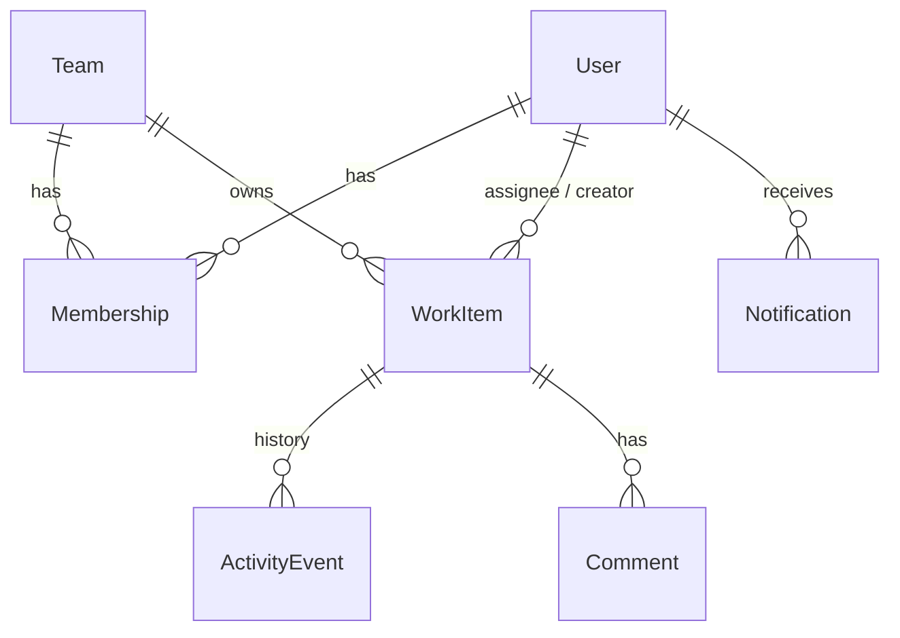
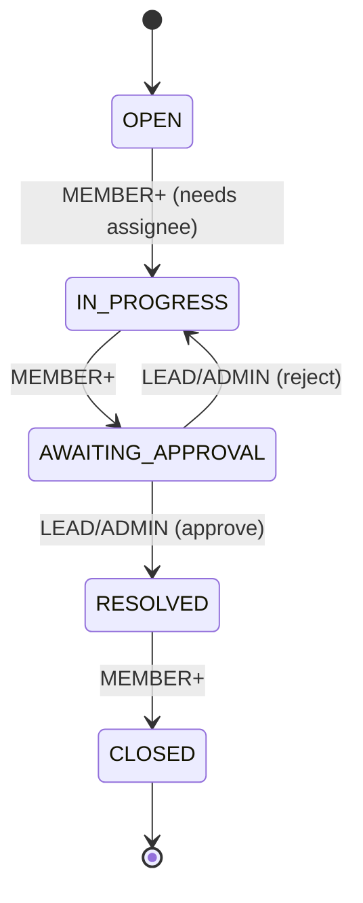

# Newtonite Ops: Design Notes

Design done before implementation: open questions and assumptions, data model, API, workflow and
permissions. The final decisions and trade-offs are written up in `ENGINEERING_DECISIONS.md`.

## 1. Open questions and assumptions

| # | Question | Assumption |
|---|---|---|
| 1 | What does a user outside the item's team get? | **404** on read and write. A 403 would confirm the item exists. **403** is only for team members whose role is too low (e.g. a VIEWER commenting). |
| 2 | Status code for an invalid transition (e.g. OPEN to CLOSED)? | **422 `INVALID_TRANSITION`**: the request is well-formed but breaks a business rule. |
| 3 | What happens on a conflict? | **409** is used only for concurrency: stale `version`, item already claimed. The body contains the latest item so the UI can show "this item changed, reload". |
| 4 | Malformed request body? | **400 `VALIDATION_ERROR`** with the failing fields. |
| 5 | Who can approve (AWAITING_APPROVAL to RESOLVED)? | Only a LEAD or ADMIN of the item's team. |
| 6 | Who can reject (AWAITING_APPROVAL to IN_PROGRESS)? | Also LEAD or ADMIN: rejecting is part of the approval decision. |
| 7 | Can work start without an owner? | No. Moving to IN_PROGRESS requires an assignee (422 `ASSIGNEE_REQUIRED`). |
| 8 | Does claiming change the status? | No. Claim and transition are separate actions, each atomic on its own. |
| 9 | Can a MEMBER set priority? | Yes when creating the item; changing it later is LEAD+. |
| 10 | How is ADMIN different from LEAD? | In this scope ADMIN = LEAD, limited to their own teams. No global superuser; membership management is not built. |
| 11 | Can an item move to another team? | No, `teamId` is fixed at creation. This keeps authorization stable. |
| 12 | Can CLOSED items be edited? | No (422 `ITEM_CLOSED`). CLOSED is terminal. |
| 13 | Which idempotent responses are stored? | Only successful ones. A failed request rolls back its key, so the client can retry. |
| 14 | Same Idempotency-Key, different payload? | 422 `IDEMPOTENCY_KEY_REUSED`. |
| 15 | Who gets notified? | New assignee on reassignment; the team's leads when an item reaches AWAITING_APPROVAL; the assignee when their item is approved or rejected. Claiming for yourself sends nothing. |
| 16 | Real-time updates? | No websockets: the UI re-fetches every 15 s and on window focus. |

## 2. Data model

| Table | Key columns | Notes |
|---|---|---|
| User | id, email (unique), name, passwordHash | bcrypt hash |
| Team | id, name (unique) | |
| Membership | (userId, teamId) PK, role | Role is per team: VIEWER, MEMBER, LEAD, ADMIN |
| WorkItem | id, title, description, type, priority, status, teamId, assigneeId?, createdById, dueDate?, **version**, createdAt, updatedAt | `version` is used for optimistic locking |
| ActivityEvent | id, itemId, actorId, type, from (json), to (json), createdAt | Append-only; a DB trigger rejects UPDATE and DELETE |
| Comment | id, itemId, authorId, body, createdAt | |
| IdempotencyKey | userId, key, route, requestHash, responseStatus, responseBody | unique (userId, key) |
| OutboxJob | id, type, payload, status, attempts, maxAttempts, nextRunAt, lockedAt, lastError, dedupeKey (unique) | PENDING, PROCESSING, DONE, FAILED |
| Notification | id, userId, itemId, message, dedupeKey (unique) | Written by the worker; the unique key makes handlers idempotent |

### Indexes (matching the dashboard queries)

- `WorkItem (teamId, createdAt DESC, id DESC)`: team list, newest first
- `WorkItem (teamId, status, createdAt DESC, id DESC)`: status filter and "awaiting my approval"
- `WorkItem (assigneeId, status, createdAt DESC, id DESC)`: "assigned to me"
- Partial index `WorkItem (teamId, createdAt DESC, id DESC) WHERE priority='URGENT' AND assigneeId IS NULL AND status IN ('OPEN','IN_PROGRESS')`: "unassigned urgent"
- GIN `pg_trgm` on `title` and `description`: substring search
- `ActivityEvent (itemId, createdAt DESC, id DESC)`: timeline pagination

## 3. Workflow

The allowed transitions are one map on the server. Anything not in the map is rejected with 422.

## 4. Permission matrix

All endpoints use one function, `authorize(user, action, item | team)`, and every list query is filtered
to the user's teams.

| Action | VIEWER | MEMBER | LEAD | ADMIN | Not in team |
|---|---|---|---|---|---|
| Read item, activity | yes | yes | yes | yes | 404 |
| Create item | 403 | yes | yes | yes | 404 |
| Comment | 403 | yes | yes | yes | 404 |
| Claim unassigned item | 403 | yes | yes | yes | 404 |
| Edit title, description, type, due date | 403 | yes | yes | yes | 404 |
| Non-approval transitions | 403 | yes | yes | yes | 404 |
| Approve / reject | 403 | 403 | yes | yes | 404 |
| Reassign / unassign | 403 | 403 | yes | yes | 404 |
| Change priority | 403 | 403 | yes | yes | 404 |

## 5. API

| Method | Path | Notes |
|---|---|---|
| POST | /api/auth/login | email + password; sets httpOnly cookie, also returns the token for `Authorization: Bearer` |
| POST | /api/auth/logout | clears the cookie |
| GET | /api/me | current user and team roles |
| GET | /api/items | `status, priority, type, team, assignee (id, me, none), q, view, cursor, limit` |
| POST | /api/items | `Idempotency-Key` header supported |
| GET | /api/items/:id | item + what the current user may do with it |
| PATCH | /api/items/:id | requires `version`; 409 with the latest item on mismatch |
| POST | /api/items/:id/claim | atomic; 409 if someone else got it first |
| POST | /api/items/:id/transition | `{ to, version }`; `Idempotency-Key` supported |
| GET | /api/items/:id/activity | cursor-paginated timeline |
| POST | /api/items/:id/comments | |
| GET | /api/teams/:id/members | for the assignee dropdown |
| GET | /api/notifications | notifications produced by the worker |

Views: `assigned_to_me`, `unassigned_urgent`, `awaiting_my_approval`.

Pagination is keyset on `(createdAt DESC, id DESC)`; the cursor is an opaque base64url string. No OFFSET.

Error format: `{ "error": { "code": "VERSION_CONFLICT", "message": "...", "details": { ... } } }`

## 6. Critical behaviours (planned)

| Situation | Approach |
|---|---|
| Two users claim the same item | `UPDATE ... WHERE id = ? AND assigneeId IS NULL`; 0 rows updated means 409 |
| Editing a stale version | `UPDATE ... WHERE id = ? AND version = ?`, then increment; 409 with the latest item |
| Repeated request | `Idempotency-Key` row inserted first in the same transaction; a repeat returns the stored response |
| Workflow rules | Allowed-transitions map on the server; approval only for the team's LEAD or ADMIN |
| Resource-level authorization | One `authorize()` function; every query scoped to the user's teams |
| Reliable async work | Outbox row written in the same transaction; worker uses `FOR UPDATE SKIP LOCKED`, backoff, max attempts, idempotent handler |
| Optimistic UI | Update immediately; roll back and show the server's reason on 409 or 403 |

Every state, assignee, priority and comment change writes its ActivityEvent in the same transaction as the item update.
